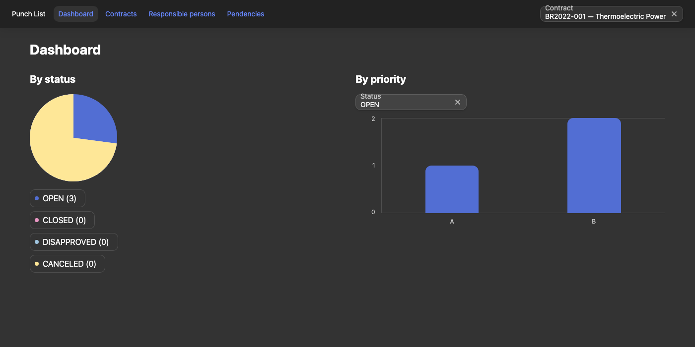
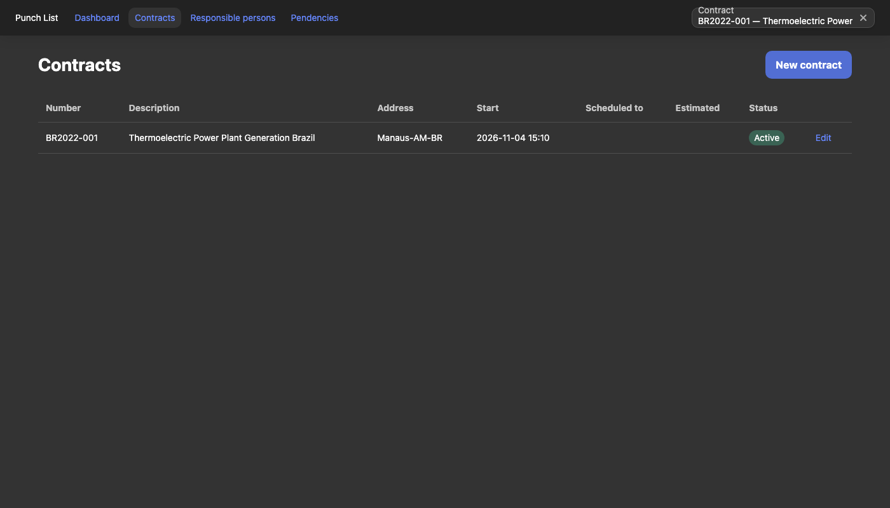
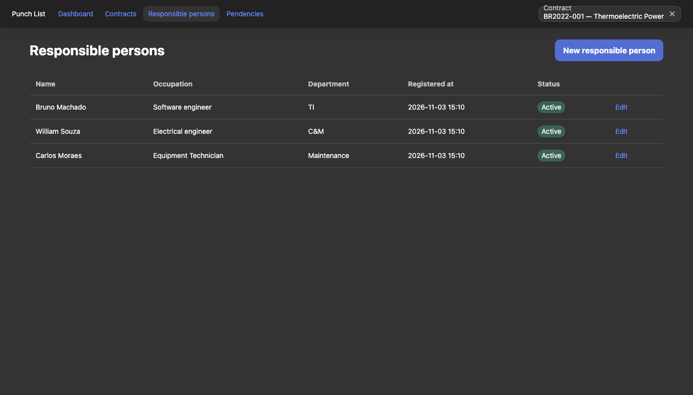
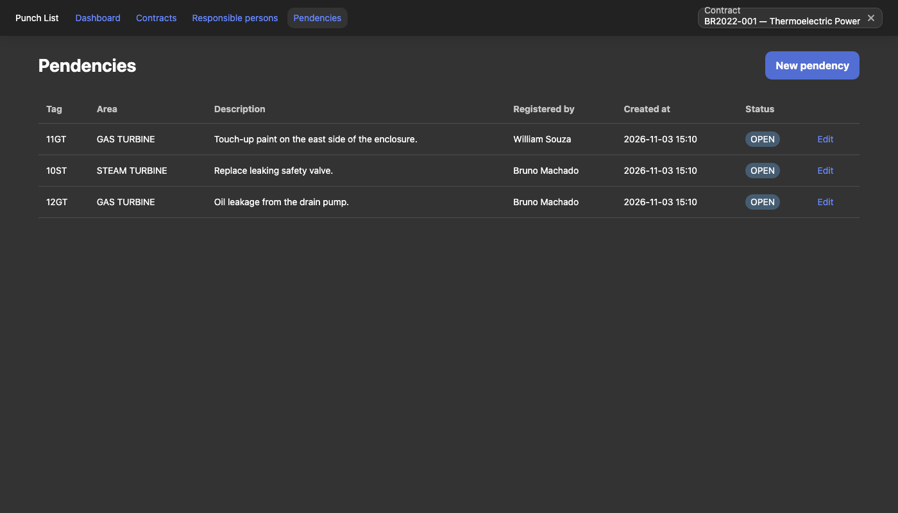
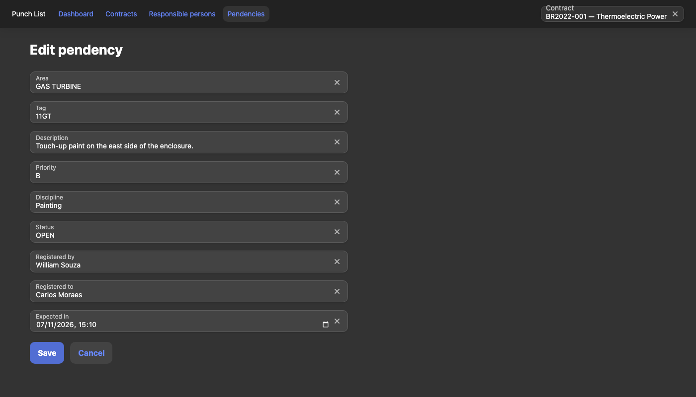

# Punch List App
## _Application for registering pending EPC contract or similar_

## Features
- Dashboard with charts: pendencies of the selected contract by status (pie) and by priority (bars, filtered by status)
- Contract registration and editing
- Responsible person registration and editing (paginated list per contract)
- Pendency registration and editing, with status rules: `OPEN`, `CLOSED`, `DISAPPROVED` and `CANCELED`; the "by" and "at" fields of the chosen closing status are required
- Contract selector in the header: the dashboard, responsible persons and pendencies show the selected contract, and the choice is kept across reloads
- English and Brazilian Portuguese (EN / PT-BR switch in the header; first visit follows the browser language). Taiga texts, dates, currency and the API error messages follow the chosen language. See [docs/conhecimento/modulos/i18n.md](docs/conhecimento/modulos/i18n.md) for the key naming standard
- Light and dark themes: follows the operating system until the user picks one in the header (sun/moon button); the choice is kept in `localStorage` (`tuiDark`)

## Screenshots











## Tech stack

- [Angular](https://angular.dev) 22: standalone components, zoneless change detection, signals and Signal Forms
- [Taiga UI](https://taiga-ui.dev) 5.31 (core, kit, layout, charts, icons)
- [Transloco](https://jsverse.gitbook.io/transloco) 8.4 for i18n (English and Brazilian Portuguese, runtime switch)
- TypeScript 6, RxJS 7.8
- [Vitest](https://vitest.dev) (with jsdom) through `ng test`
- ESLint with angular-eslint and typescript-eslint, Prettier

## Prerequisites

- Node `^22.22.3 || ^24.15` and npm
- The API running at `http://localhost:8080`: [punch-list-api](https://github.com/djbrunoramon/punch-list-api)

## Getting started

```bash
npm ci
npm start          # ng serve at http://localhost:4200; /api is proxied to http://localhost:8080
npm test           # unit tests (Vitest)
npm run lint       # ESLint (ts and html)
npm run build      # production build in dist/punch-list-app
```

## Running the full stack

In the API repository, start it with `./mvnw spring-boot:run` (or, with in-memory H2 and no Docker, `./mvnw spring-boot:run -Dspring-boot.run.profiles=h2`). Then, in this repository:

```bash
npm start
```

Open `http://localhost:4200`.

## Configuration

- `apiBaseUrl` in `src/environments/environment.ts` (production build) and `src/environments/environment.development.ts` (`npm start`): origin prepended to every `/api/v1/...` call. It is empty by default, so calls are relative.
- `API_BASE_URL` (`src/app/core/config/api-base-url.ts`) is the Angular injection token that exposes `environment.apiBaseUrl`; services and tests inject it (it is not an OS environment variable).
- `proxy.conf.json` forwards `/api` to `http://localhost:8080` in `npm start`.
- In production, leave `apiBaseUrl` empty if the app is served from the same origin as the API (reverse proxy). Otherwise set it to the API origin before building, and make sure the API allows the origin of this app in `APP_CORS_ALLOWED_ORIGINS`.
- Do not put secrets in `environment*.ts`: everything there goes into the public bundle.

## Project structure

```
src/app/
  app.ts, app.config.ts, app.routes.ts
  core/                     # app-wide singletons
    api-error/              # ApiError + interceptor (ProblemDetail)
    config/                 # API_BASE_URL
    contract-context/       # selected contract (persisted in localStorage)
    layout/                 # shell: header, navigation, contract selector
  shared/                   # models (Page), ui (page-state), util (date-time, server-errors)
  features/<feature>/       # dashboard, contracts, responsible-persons, pendencies
    data-access/            # <x>.api.ts (HTTP) and <x>.models.ts
    pages/                  # <x>-list.page, <x>-form.page (ts + html)
    <feature>.routes.ts     # lazy routes
src/environments/           # apiBaseUrl
src/testing/                # test fixtures
```

Conventions: standalone components with `OnPush`, `inject()` instead of constructor injection, signals, `rxResource` for loading data, Signal Forms (`@angular/forms/signals`) for forms, and the shared `<app-page-state>` for the loading, error and empty states of each page.

## Error handling

The API reports errors as RFC 9457 ProblemDetail (`application/problem+json`). `apiErrorInterceptor` turns every failed HTTP call into an `ApiError` (`status`, `title`, `detail`, `fieldErrors`). Non-ProblemDetail bodies (for example an HTML error page) are never shown; a friendly message is used instead. Field errors (`errors: [{field, message}]` of a 400) are mapped to the matching form control, and the `detail` of other errors (for example a 422 business rule) is shown on the page.

## Note about `docs/`

`docs/` contains the old published build (Angular 13) and the screenshots in `docs/img/`. The new build goes to `dist/`. Deployment is out of scope of this README.

## Knowledge base

Architecture decisions (ADRs), living specification, open technical debt and runbooks live in
[docs/conhecimento](docs/conhecimento/index.md) (Portuguese, [OKF](https://github.com/GoogleCloudPlatform/open-knowledge-format) format).
